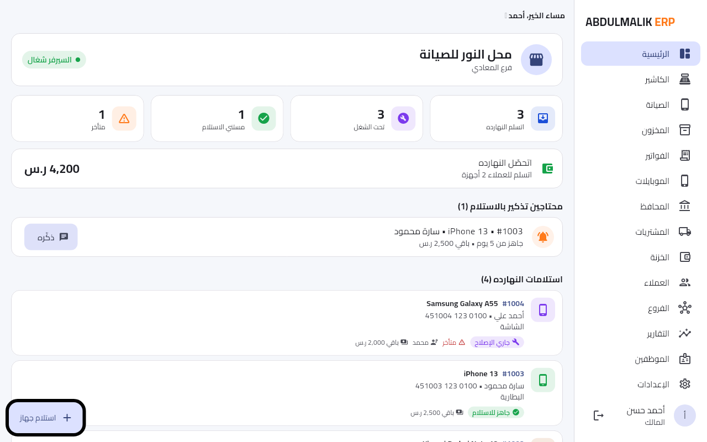
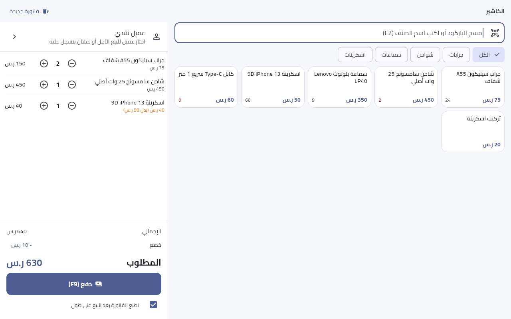
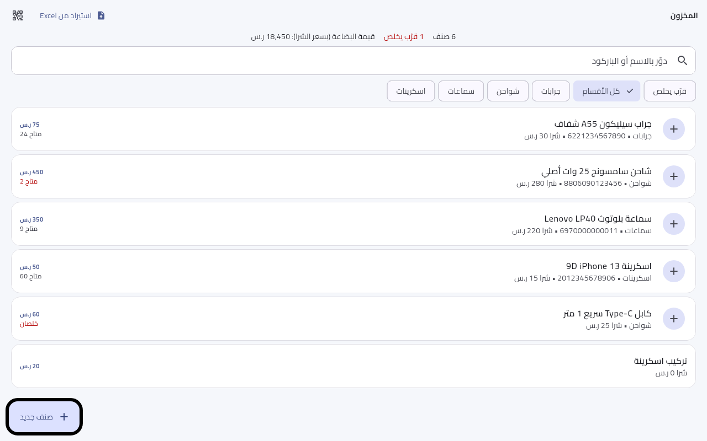

<div align="center">


# ABDULMALIK ERP

**نظام إدارة متاجر بيع وصيانة الهواتف — Windows x64**

An offline-first desktop ERP for phone retail and repair shops.

[العربية](README_AR.md) · [English](README_EN.md) · [Architecture](ARCHITECTURE.md) · [Development](DEVELOPMENT.md) · [Roadmap](ROADMAP.md)


</div>

## Product overview

ABDULMALIK ERP brings the daily operations of a phone shop into one local application: repair tickets, point of sale, general inventory, a dedicated accessories section, phones tracked by IMEI, purchases, customers, cash drawer, service transactions, reports, user roles, audit history, and backup/restore.

The Windows computer is the local host. The app stores operational data in SQLite and exposes a local HTTP service for devices on the shop LAN. Core Windows workflows are designed to work without an internet connection.

## Current release boundary

- **Release target:** Windows x64 desktop and its Inno Setup installer.
- **Android:** source and a manual experimental build workflow are retained, but Android is not declared production-ready in this release.
- **Cloud:** Firebase/Firestore code and rules are retained as a development base. Cloud sync is disabled by default, Firebase configuration is empty, and public customer tracking is disabled.
- **In-app licensing:** activation, subscriptions, trials, and device limits are not enforced by this edition. This does not grant copyright, redistribution, or sublicensing rights; see `LICENSE_STATUS.md`.
- **Network security:** local LAN transport and cryptographic handling require further security review before exposure to untrusted networks.

Do not interpret a successful compilation as proof of production security. Review [Security](SECURITY.md) and the technical study before deploying with live customer data.

## Main capabilities

| Module | Scope represented in source |
|---|---|
| Repairs | Intake, repair stages, approvals, parts, technician assignment, delivery and warranty records |
| POS | Barcode sales, invoices, returns, customer balances, cash drawer sessions and expenses |
| Accessories | Separate accessories view and category filter while using the shared product and stock model |
| Inventory | Products, categories, stock movements, suppliers, purchases, barcode labels and spreadsheet import |
| Phones | New devices by IMEI and used-device purchase records |
| Services | Wallet/recharge and shop service transactions with commission records |
| Customers | Customer records and transaction history |
| Reports | Operational and financial reports with export options |
| Administration | Users, roles, audit history, diagnostics, backup and restore |

Feature presence in source is not a substitute for acceptance testing in a real shop.

## Screenshots

| Dashboard | POS | Accessories / products |
|---|---|---|
|  |  |  |

## Technology

- Flutter / Dart desktop application.
- Riverpod for application state.
- SQLite for local persistence and versioned migrations.
- `shelf` and `shelf_router` for the local HTTP API.
- Local file storage for product images and backups.
- Optional Firebase/Firestore integration retained but disabled by default.

See [ARCHITECTURE.md](ARCHITECTURE.md) for the system boundaries and [DEVELOPMENT.md](DEVELOPMENT.md) for setup instructions.

## Build the Windows release

Required on a Windows 10/11 x64 build machine:

- Flutter stable SDK matching the Dart constraint in `source/pubspec.yaml`.
- Visual Studio 2022 Build Tools with **Desktop development with C++**.
- Inno Setup 6.

Run in PowerShell:

```powershell
cd source
flutter doctor -v
powershell -ExecutionPolicy Bypass -File .\tool\build_release.ps1
```

The release script restores packages, runs analysis and tests, builds the Windows x64 release bundle, and creates `builds/ABDULMALIK-ERP-Setup-<version>.exe`. The GitHub Actions Windows workflow performs validation and installer smoke testing on its Windows runner.

## Data and deployment precautions

1. Test backup and restore against a disposable database before production use.
2. Keep the Windows host on a trusted, access-controlled LAN.
3. Do not expose the local HTTP service directly to the public internet.
4. Do not enable Firebase until a separately owned project, security rules, privacy requirements, and credentials have been reviewed.
5. Keep signing keys, private keys, `key.properties`, keystores, and `.env` files out of Git.

## Maintainer and provenance

The product profile and project documentation are maintained under the ABDULMALIK ERP / M.GH.AL project identity. Product branding is distinct from source-code authorship. The upstream repository, import reference, and known contributor provenance are documented in [PROVENANCE.md](PROVENANCE.md). Third-party license and copyright notices must remain intact.

No open-source license file was present in the inspected upstream snapshot. See [LICENSE_STATUS.md](LICENSE_STATUS.md) before redistribution or sublicensing.

## Project documents

- [Arabic README](README_AR.md)
- [English README](README_EN.md)
- [Architecture](ARCHITECTURE.md)
- [Development and build guide](DEVELOPMENT.md)
- [Security policy and known limitations](SECURITY.md)
- [Roadmap](ROADMAP.md)
- [Changelog](CHANGELOG.md)
- [Provenance and attribution](PROVENANCE.md)
- [License status](LICENSE_STATUS.md)
- [Independent migration report](MIGRATION_REPORT.md)
- [Comprehensive technical study](docs/COMPREHENSIVE_PROJECT_STUDY.md)
- [Accessories module and progress](docs/ACCESSORIES_AND_PROGRESS.md)
